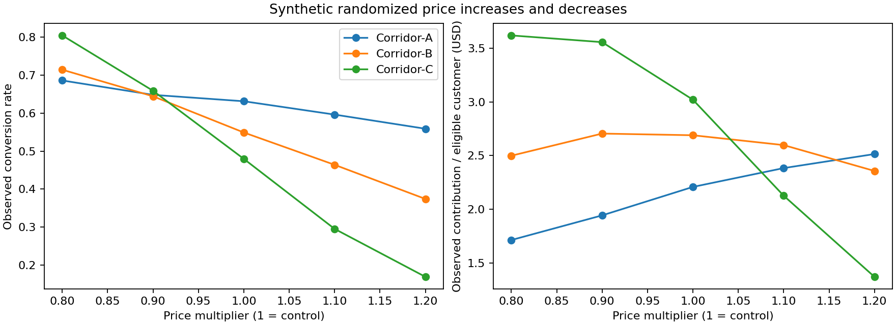

# Corridor Price Experiments: Elasticity and Balanced Pricing

> Independent portfolio project inspired by experience in remittance pricing experimentation. All customers, corridors, prices, policies and outcomes are synthetic. This is not an employer implementation or a reproduction of an employer's results.

## Business question

**How do price increases and decreases change customer conversion in each corridor, and which tested price best balances business contribution with customer response?**

This project focuses entirely on randomized price experiments. It complements the earlier model-based remittance-pricing lab and is a separate repository.

## Experiment design

A fictional remittance business randomizes eligible customers within each of three fictional corridors to five price arms:

| Arm | Change vs current price | Purpose |
|---|---:|---|
| 0.8× | −20% | Measure response to a larger reduction |
| 0.9× | −10% | Measure response to a smaller reduction |
| 1.0× | Control | Current price benchmark |
| 1.1× | +10% | Measure response to a smaller increase |
| 1.2× | +20% | Measure response to a larger increase |

The screening sample contains 25,000 eligible customers per corridor. Each customer receives exactly one price and one observed conversion outcome; randomization is at the customer level. In real experiments, persistent assignment across repeated visits would be essential. Send amount is fixed at $300 to isolate the pricing question. Price is one all-in USD-equivalent charge, with fixed processing cost; separate fee/FX-spread experiments are outside this case.

Prices are randomly assigned independently of propensity to convert. The response curves are different across corridors by construction; no real corridor effects are implied.

## What is measured

- **Conversion:** Primary metric: converted customers / all eligible randomized customers; 
Secondary metrics: Transactions per customer (TPC), Send volume per customer (SPC)
- **Revenue per eligible customer:** total price revenue / all eligible randomized customers (RPC)
- **Contribution per eligible customer:** (price revenue − processing costs on completed transfers) / all eligible randomized customers (PPC)
- **Price elasticity:** midpoint (arc) percentage change in conversion divided by midpoint percentage change in assigned price, separately for each treatment versus control.

Arc elasticity uses `(conversion_treatment − conversion_control) / their average`, divided by `(price_treatment − price_control) / their average`. Negative values indicate that conversion moves opposite to price. It describes the finite price change tested, not one constant elasticity for all prices. The constant send amount makes price multipliers comparable within a corridor.

All randomized eligible customers remain in the denominator, including non-converters. Analyzing only completed transactions would miss customers lost because of a price increase.

## Choosing a balanced price

1. Estimate conversion, revenue and contribution in each randomized arm.
2. Compare each increase and decrease with control; report uncertainty rather than just point estimates.
3. Apply a conversion non inferiority guardrail: the candidate arm must be statistically consistent with **no more than a 10% relative loss in conversion**. This threshold is independently chosen for illustration, not an employer policy.
4. Among the tested arms passing that guardrail, choose the highest observed contribution per eligible customer. Current price remains eligible as a fallback.
5. Freeze the candidate and test it against current price in **a new, independent confirmatory experiment** (16,000 customers per corridor with a changed candidate).
6. Require confirmation of both positive contribution gain and conversion noninferiority. Otherwise keep current price pending additional evidence.

The conversion noninferiority contrast is `p_treatment − 0.9 × p_control`. Its confidence lower bound must be nonnegative. Screening comparisons use Bonferroni-adjusted intervals over 12 corridor/treatment comparisons per metric family. Confirmation uses conservative simultaneous intervals over up to six corridor/endpoints. Elasticity bootstrap intervals are exploratory pointwise 95% intervals, not simultaneous.

The selected price is **the best tested discrete price under these constraints**, not a global or continuous optimum. Independent confirmation addresses selection noise and the winner's curse. Positive conversion lift alone does not justify a discount if contribution falls.

## Reproduce

Python 3.12 was used for verification.

```bash
python -m venv .venv
source .venv/bin/activate
pip install -r requirements-verified.txt
python run.py
python -m unittest discover -s tests -v
```

On Windows activate with `.venv\Scripts\activate`. Alternatively use `requirements.txt` for a compatible range of dependencies. Data and outputs are included for inspection without installing anything. Jupyter is optional; install it separately to use the walkthrough notebook.

## Results

Read [the generated decision memo](outputs/decision_memo.md) and [corridor recommendations](outputs/recommendations.csv). Every numerical outcome is synthetic.



## Files

| File | Use |
|---|---|
| `run.py` | Synthetic generation, arm analysis, elasticity, guardrails and independent confirmation |
| `data/customer_experiments.csv` | Customer-level screening and confirmation datasets |
| `sql/metrics.sql` | Executable intention-to-treat metrics by corridor and arm |
| `outputs/arm_metrics.csv` | Screening conversion, revenue and contribution |
| `outputs/elasticity_and_guardrails.csv` | Increase/decrease elasticity intervals and guardrail comparisons |
| `outputs/confirmation_results.csv` | Independent follow-up results for selected price changes |
| `outputs/recommendations.csv` | Final decision by corridor |
| `outputs/summary.json` | Rules, thresholds and machine-readable results |
| `outputs/experiments.sqlite` | Generated SQLite database |
| `notebooks/walkthrough.ipynb` | Guided exploration of experiment results |
| `tests/` | Randomization/data-grain, accounting, elasticity and guardrail checks |

## Quality checks and assumptions

Randomization allocation is checked with a chi-square sample-ratio-mismatch test. The pipeline stops on an allocation alarm below `0.01 / 6`, controlling a 1% alarm family across up to six phase/corridor checks. A low p-value deserves investigation; passing SRM does not prove correct implementation. On real data also audit exposure logging, pre-experiment covariate balance, exclusions, persistent assignment and customer overlap.

Confidence intervals use large-sample normal approximations for independent customer means. There are no repeated customer observations, small-count groups or cluster effects in this dataset. Do not generalize these intervals to repeated-session data without adjusting the design.

No retention, repeat transaction value, complaints, competitive response, acquisition cost or customer lifetime value is modeled. The case shows immediate price response and business contribution only. Fixed send amount and costs are deliberate simplifications. Guardrails and success criteria should be fixed before observing real results; this case assumes adequate data volume rather than claiming a prospective power calculation.
- Why measure both increases and decreases within each corridor?
- Why use contribution per eligible customer rather than revenue per completed transfer?
- Why can a discount increase conversion and still lose money?
- How does elasticity differ from absolute percentage-point conversion change?
- Why does “not significant” differ from evidence of conversion noninferiority?
- How do multiple comparisons and choosing the best arm create selection bias?
- Why might a screening winner fail independent confirmation?
- How would repeated users, send amounts and retention change the design?
